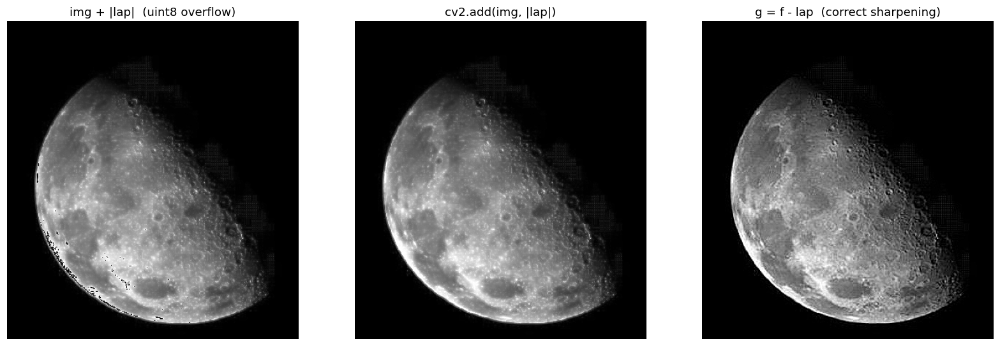
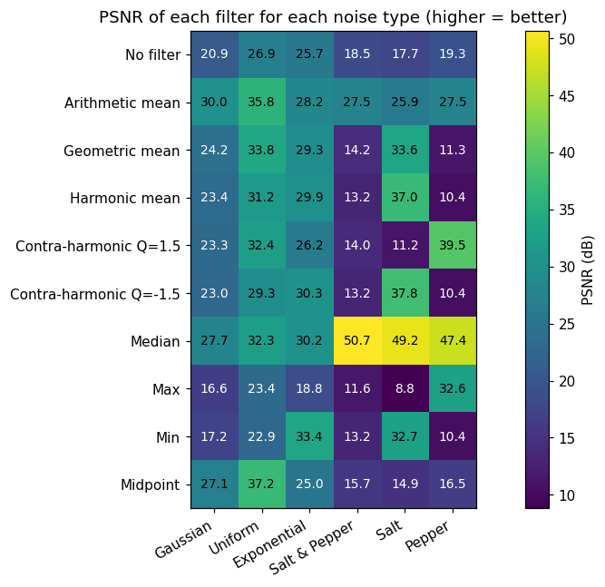
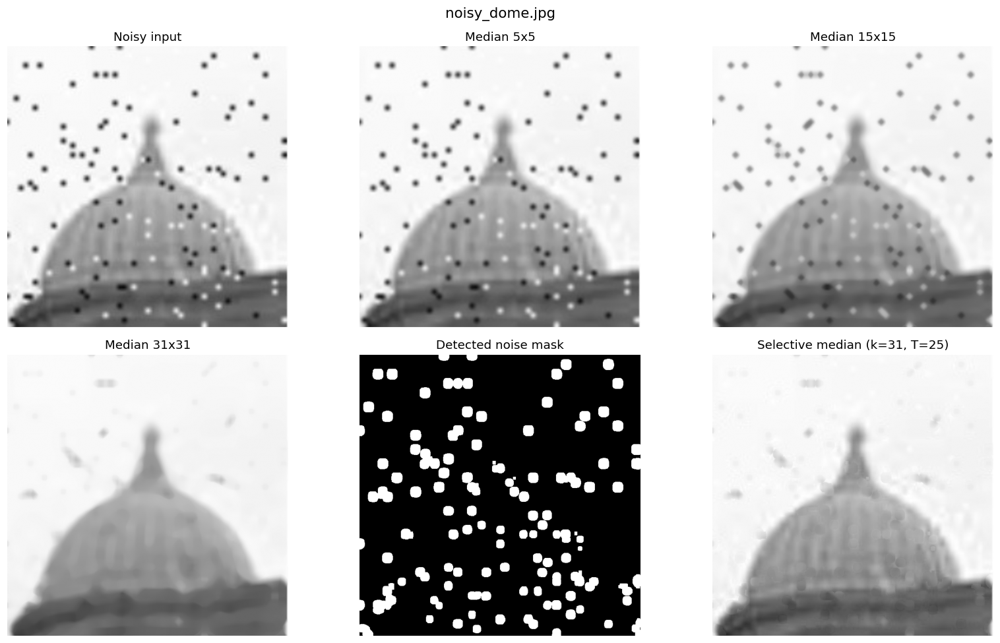

# Lab 7 – Laplacian Filter & Mathematical / Statistical Filters

**Course:** ARTI403 – Image Processing (IAU)  
**Student:** Mohammed Moayed Alquriniy – 2240007325

This lab has two parts:

- **Lab 7(A) – Laplacian Filter:** image sharpening with the second‑derivative (Laplacian) operator.
- **Lab 7(B) – Mathematical & Statistical Filters:** adding four noise models to an image and removing them with mean and order‑statistic filters.

---

## Folder structure

```
LAB7/
├── Lab_7_A_Laplacian_Filter.ipynb          # Part A notebook (executed, outputs included)
├── Lab_7_B_Maths_Statistics_Filters.ipynb  # Part B notebook (executed, outputs included)
├── Lab_7_A_Laplacian_Filter.pdf            # PDF export of notebook A
├── Lab_7_B_Maths_Statistics_Filters.pdf    # PDF export of notebook B
├── README.md
├── images/                 # REQUIRED – the notebooks read their input images from here
│   ├── moon.jpg            # input for Lab 7(A)
│   ├── noise.jpg           # clean test image for Lab 7(B)
│   ├── noisy_dome.jpg      # real noisy image (large salt & pepper blobs)
│   └── noisy_person.jpg    # real noisy image (fine salt & pepper)
└── outputs/                # optional – created automatically when the notebooks run (figures + psnr_table.csv)
```

## How to run

```bash
pip install opencv-python numpy matplotlib pandas jupyter
```

Open the notebooks in VS Code (Jupyter extension) or Jupyter Lab from inside the `LAB7` folder and choose **Run All**.
The notebooks read images from `images/` and save every figure to `outputs/`. The noise uses `np.random.seed(42)`,
so the numbers below are reproduced exactly.

---

## Lab 7(A) – Laplacian Filter

| Step | What it does |
|------|--------------|
| Manual kernel | 4‑neighbour kernel `[0 1 0; 1 -4 1; 0 1 0]` applied with `cv2.filter2D(img, cv2.CV_64F, kernel)` |
| Absolute scale | `cv2.convertScaleAbs` to display the Laplacian as 8‑bit |
| Combination | `cv2.add(img, |lap|)` and the correct sharpening `g = f − ∇²f` |
| Built‑in | `cv2.GaussianBlur` (3×3) then `cv2.Laplacian` |
| Kernel comparison | 4‑neighbour vs 8‑neighbour `[1 1 1; 1 -8 1; 1 1 1]` |
| Noisy image | Laplacian directly vs median 3×3 → Laplacian |

**Sharpness (variance of the Laplacian, higher = sharper)**

| Image | Score |
|-------|------:|
| Original | 76.5 |
| img + \|lap\| (cv2.add) | 421.8 |
| Gaussian blur + Laplacian | 158.9 |
| f − lap (4‑neighbour) | 869.6 |
| f − lap (8‑neighbour) | **3011.0** |

Notes:
- The Laplacian of the moon ranges from −123 to 110, so it must be computed in `CV_64F`.
- `img + laplacian_abs` on `uint8` overflows (541 pixels wrap from white to black) → `cv2.add` or float arithmetic is used.
- The Laplacian amplifies noise, so noisy images are denoised (median 3×3) before sharpening.



---

## Lab 7(B) – Mathematical & Statistical Filters

**Noise models:** Gaussian (var 0.01), Salt & Pepper (4%), Exponential (scale 10), Uniform [−20, 20], plus salt‑only and pepper‑only.

**Filters:** arithmetic mean, geometric mean, harmonic mean, contra‑harmonic (Q = ±1.5), median, max, min, midpoint.

### PSNR (dB) – 3×3 window, higher is better

| Filter | Gaussian | Uniform | Exponential | Salt & Pepper | Salt | Pepper |
|---|---:|---:|---:|---:|---:|---:|
| No filter | 20.85 | 26.87 | 25.69 | 18.52 | 17.73 | 19.30 |
| Arithmetic mean | **30.01** | 35.81 | 28.21 | 27.52 | 25.95 | 27.52 |
| Geometric mean | 24.18 | 33.80 | 29.31 | 14.19 | 33.64 | 11.35 |
| Harmonic mean | 23.44 | 31.25 | 29.85 | 13.19 | 37.01 | 10.42 |
| Contra‑harmonic Q=1.5 | 23.28 | 32.35 | 26.17 | 14.04 | 11.25 | 39.51 |
| Contra‑harmonic Q=−1.5 | 23.01 | 29.32 | 30.32 | 13.19 | 37.79 | 10.42 |
| Median | 27.73 | 32.34 | 30.19 | **50.67** | **49.25** | **47.40** |
| Max | 16.64 | 23.36 | 18.77 | 11.56 | 8.84 | 32.64 |
| Min | 17.18 | 22.91 | **33.44** | 13.16 | 32.67 | 10.41 |
| Midpoint | 27.12 | **37.17** | 24.99 | 15.65 | 14.95 | 16.48 |

**Best filter per noise type**
- Gaussian → arithmetic mean
- Uniform → midpoint
- Exponential → min (exponential noise is one‑sided / only brightens)
- Salt & Pepper, Salt, Pepper → median
- Contra‑harmonic: Q > 0 removes pepper, Q < 0 removes salt; the wrong sign makes the noise worse.



### Real noisy images
- `noisy_person.jpg` – fine impulse noise, removed by a 3×3 median filter.
- `noisy_dome.jpg` – the noise dots are ~20 px blobs, so small medians do not remove them and a 31×31 median blurs the dome.
  A **selective median** (replace only pixels that differ from the 31×31 median by more than 25 grey levels, ≈13% of the image) removes all the dots and keeps the dome details.



---

## Changes made to the provided lab code
- Image paths point to the `images/` folder; figures are saved to `outputs/`.
- `img + laplacian_abs` replaced with `cv2.add` (uint8 overflow fix), and the correct `f − ∇²f` sharpening added.
- Lab 7(B) cells that printed raw arrays now display images; the manual mean filter is applied to the noisy image (it was applied to the clean one).
- Each filter is applied to the noise type it is designed for (e.g. median on salt & pepper, max on pepper, min on salt), and a full PSNR comparison was added.
